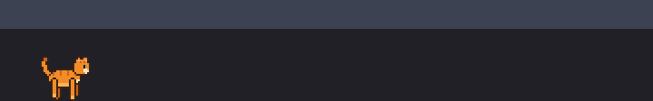

# Taskbar Cat



A Windhawk mod: an orange pixel-art cat that lives on the Windows 11 taskbar.

It wanders, sits, loafs, grooms, scratches, kneads, chases its tail and naps
(with Zzz). Hover over it and it purrs, click and it meows, double-click for a
belly roll, drag to pick it up by the scruff. Move the cursor fast near it and
it pounces. It reacts to new windows and flashing taskbar buttons, greets you
when you come back, dances to music, asks for food at mealtimes, plays with
yarn, stalks butterflies, leaves you gifts, wears seasonal hats, and can meow
and purr out loud (off by default).

## Install or update in Windhawk

1. Copy all of `taskbar-cat.wh.cpp`.
2. First time: Windhawk, **Create a New Mod**, select all, paste, **Compile Mod**, **Exit Editing Mode**.
   Updating: **Installed Mods**, Taskbar Cat, **Details**, **Edit**, select all, paste, **Compile Mod**.
3. Settings are under the mod's **Details**, then **Settings**.

## What's where

| Path | What |
|---|---|
| `taskbar-cat.wh.cpp` | The mod. One file, as Windhawk requires. |
| `art/cat_sheet.png`, `art/animations.json` | The sprite sheet and its timings and head anchors. |
| `tools/cat_rig.py` | Draws every frame from simple shapes and writes the sheet. Stop running it once you hand-edit the sheet. |
| `tools/sprites_to_cpp.py` | Converts the sheet into the generated block inside the mod. Owns the palette. |
| `tools/make_preview_gif.py` | Renders `art/preview.gif` from the sprite sheet. |
| `tools/make_public.py` | Adds the publishing metadata for the Windhawk mods repository. |
| `tools/soak.ps1` | Runs the harness for a while and checks handle and GDI counts stay flat. |
| `harness/harness.cpp` | Runs the mod as a normal exe over the taskbar, no explorer injection needed. |
| `tests/engine_tests.cpp` | Unit tests for the pure parts: behaviour engine, toys, music detection, sounds, compositing. |
| `build.ps1` | Checks the mod compiles the Windhawk way, builds tests and harness, runs the tests. |

## Working on it

```powershell
.\build.ps1             # compile check + tests
.\build.ps1 -Harness 20 # also show the cat for 20 seconds from the harness
python tools\cat_rig.py; python tools\sprites_to_cpp.py   # after changing art
```

`build.ps1` uses the clang that ships with Windhawk, so nothing else needs installing.
The tests write the synthesised sounds to `build/*.wav` so you can listen to them.

## How it works

- The mod hooks nothing. It starts a thread inside explorer that creates two small
  layered windows owned by the taskbar (the cat and its toy) and draws them with
  per-pixel alpha, so empty space stays click-through.
- `engine` is a pure state machine: needs (energy, boredom, affection) drift over
  time and weight what the cat does next; mouse, Windows events, music and meals
  interrupt it. Everything takes the time and a `World` snapshot as input, which is
  why it can be tested without a screen.
- Sprites are generated from shapes, run-length encoded into the source, and
  decoded once at startup.
- Sounds are synthesised at startup (pitch contour plus moving vowel formants for
  the meow, filtered pulsing noise for the purr) and played from memory.

## License

MIT, see [LICENSE](LICENSE).
